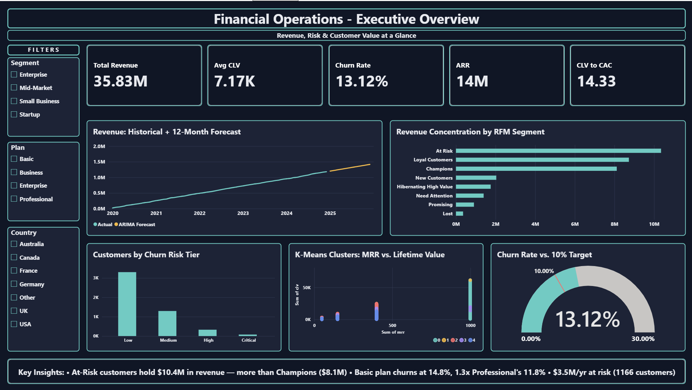
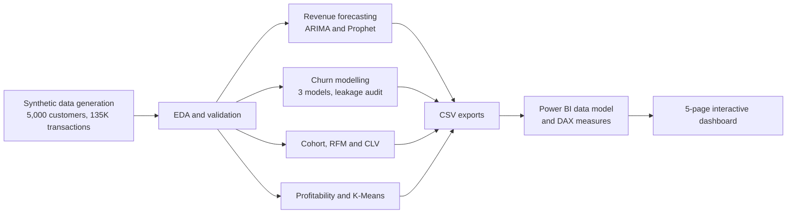
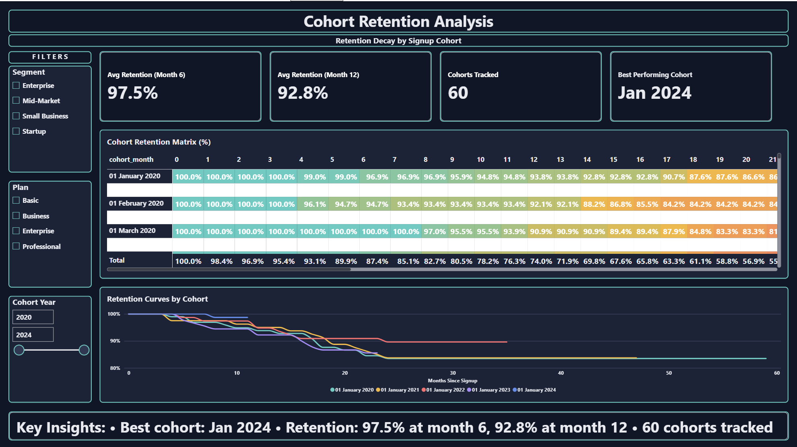
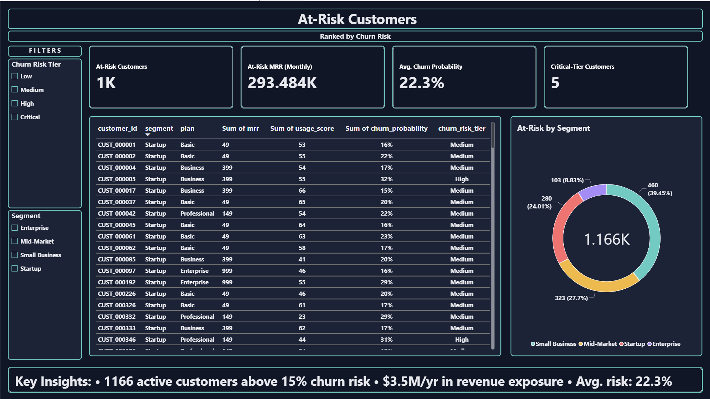
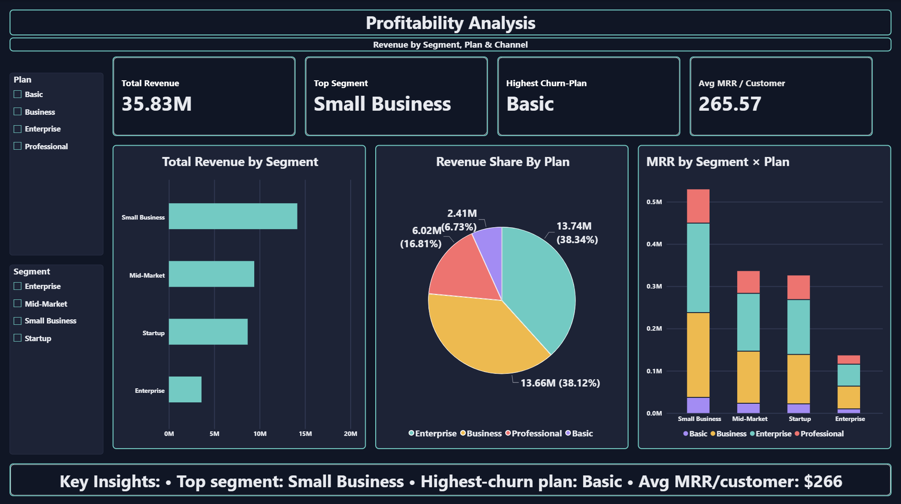
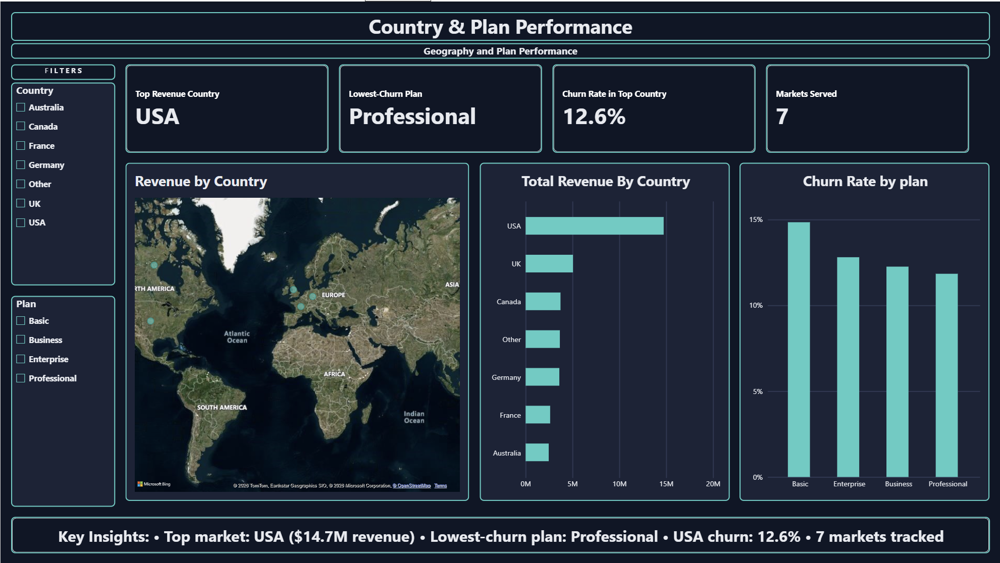
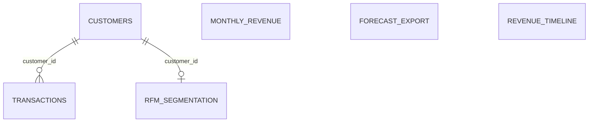

# 💹 Financial Operations Analytics

### End-to-end SaaS analytics: revenue forecasting, churn prediction, customer segmentation and a 5-page interactive Power BI dashboard


A simulated 5-year SaaS business (2020–2024) analysed end to end. Python handles the forecasting, churn modelling and segmentation; a 5-page Power BI dashboard turns the results into something a finance or customer-success team could use. Every KPI, chart and insight sentence on the dashboard recalculates live as filters change.



---

## 📊 At a Glance

| Metric | Value |
|---|---|
| Customers | 5,000 |
| Transactions | 135,218 |
| Total revenue (2020–2024) | **$35.83M** |
| Annual recurring revenue (ARR) | **$13.9M** |
| Churn rate | **13.12%** (656 of 5,000) |
| Average customer lifetime value | **$7,167** |
| CLV : CAC (assumed $500 CAC) | **14.33x** |
| 12-month revenue forecast (ARIMA) | **$15.70M** |
| Forecast error on held-out months (MAPE) | **0.77%** |
| Churn model ROC AUC (after leakage fix) | **0.756** |
| Revenue at risk | **$3.5M / year** across **1,166** active customers |

---

## 📑 Table of Contents

1. [Business Problem](#-business-problem)
2. [Key Findings](#-key-findings)
3. [Project Pipeline](#-project-pipeline)
4. [Dataset](#-dataset)
5. [Methodology and Results](#-methodology-and-results)
6. [Power BI Dashboard](#-power-bi-dashboard)
7. [Data Quality and Debugging Log](#-data-quality-and-debugging-log)
8. [Assumptions and Limitations](#-assumptions-and-limitations)
9. [Repository Structure](#-repository-structure)
10. [How to Reproduce](#-how-to-reproduce)
11. [Tech Stack](#-tech-stack)
12. [Next Steps](#-next-steps)
13. [Author](#-author)

---

## 🎯 Business Problem

A subscription business needs a clear answer to four questions:

1. **How much revenue will we make over the next 12 months?**
2. **Which customers are about to leave, and what are they worth?**
3. **Which customers are the most valuable, and how do they behave?**
4. **Where is the business strongest (segment, plan, geography), and where is it leaking?**

This project answers each one with a model or analysis, then packages the answers into a dashboard built for exploration rather than a single static view.

---

## 🔍 Key Findings

1. **Revenue is growing steadily and is forecastable.** Monthly revenue grew 13.26% over the latest six months versus the six before. ARIMA(1,1,1) and Prophet land within 1% of each other on the 12-month forecast ($15.70M vs $15.83M).
2. **The most valuable customer group is also the one drifting away.** The RFM "At Risk" segment holds **$10.4M** in revenue, more than "Champions" ($8.1M). High-value accounts with slipping recency are a bigger revenue exposure than the loyal core.
3. **1,166 active customers sit above a 15% churn probability**, representing **$293K of monthly recurring revenue ($3.5M a year)**.
4. **The Basic plan churns the most.** 14.8% against 11.8% for Professional (about 1.3x), and it has the lowest lifetime value of any plan.
5. **Retention decays gradually, with no cliff.** Average retention is 97.5% at month 6 and 92.8% at month 12. Churn timing is spread across months 3 to 24 by design.
6. **Customer behaviour cuts across price tiers.** K-Means found five behavioural clusters; even customers on the same $999 plan split across clusters based on usage, NPS, support load and tenure.
7. **Churn is driven by usage, not by segment, plan or country.** Churn rates are flat across segments (12.7% to 13.7%), which is exactly what the data was built to show: the only planted signal is usage score.

---

## 🧭 Project Pipeline



---

## 🗂️ Dataset

All data is **synthetic** and generated inside the notebook with a fixed random seed (`42`), so every run reproduces the same 5,000 customers and 135,218 transactions. No real customer or company data is used.

| Design choice | Detail |
|---|---|
| Time window | Jan 2020 to Dec 2024 (60 months) |
| Segments | Enterprise 10%, Mid-Market 25%, Small Business 40%, Startup 25% |
| Plans and monthly price | Basic $49, Professional $149, Business $399, Enterprise $999 |
| Geography | 7 markets: USA, UK, Canada, Germany, France, Australia, Other |
| Behavioural fields | Usage score, NPS score, support tickets, contract length, number of users |
| Billing noise | ±10% natural variation per payment, plus a 5% chance of a 20–50% upsell |
| **Planted signal** | Churn probability = `max(0.05, (100 − usage_score) / 200)` |

**Why plant a signal?** Real churn data has no answer key. Tying churn to usage score means every later model has a known truth to recover, so a good model can be told apart from a lucky one. It also means NPS, support tickets, segment and plan carry no true churn signal here, which is an expected result and not a modelling failure.

| Data file | Contents |
|---|---|
| `financial_customers.csv` | One row per customer: attributes, behaviour, churn flag and date |
| `financial_transactions.csv` | One row per monthly payment (about 11 MB) |
| `monthly_revenue.csv` | Revenue aggregated to 60 months |
| `forecast_export.csv` | ARIMA and Prophet 12-month forecasts |
| `at_risk_customers.csv` | Active customers above the risk threshold |
| `rfm_segmentation.csv` | RFM scores and segment labels |
| `customers_for_powerbi.csv` | Customer table with churn probability, risk tier and cluster, built for the dashboard |

---

## 🧪 Methodology and Results

### 1. Data generation and validation
Customers are created with weighted sampling, then each customer's churn decision and monthly transactions are generated in a single loop. The order of random draws matters: with the seed fixed, the notebook reproduces exactly **656 churned customers (13.12%)**, **135,218 transactions** and **$35,834,169.55** in revenue, and those figures are used as checkpoints.

### 2. Revenue forecasting
Seasonal decomposition, an ADF stationarity test (not stationary; stationary after one difference, p = 0.0001), ACF/PACF review, then **ARIMA(1,1,1)** trained on 48 months and tested on 12. **Prophet** was fitted as an independent second approach.

| Model | 12-month forecast | Notes |
|---|---|---|
| ARIMA(1,1,1) | $15.70M | MAE $8,170, MAPE **0.77%** on the held-out 12 months |
| Prophet | $15.83M | Within 0.9% of ARIMA |

Two honest caveats: the AR coefficient sits at the unit-root boundary (the forecast is a smooth trend line), and the seasonal component Prophet fits is small relative to monthly revenue, because no seasonality was built into the data.

### 3. Churn prediction
Three models compared: Logistic Regression, Random Forest and Gradient Boosting, on an 80/20 stratified split.

**The leakage audit.** The first run scored a **1.000 ROC AUC**. Feature importance showed `recency_days` carrying 52% of the weight. Four features (`recency_days`, `lifetime_months`, `transaction_count`, `tickets_per_month`) are computed from transaction history that stops the moment a customer churns, so they encode the outcome. They were removed and the models retrained on 15 genuine leading indicators.

| Model | ROC AUC (leaky) | ROC AUC (clean) |
|---|---|---|
| Logistic Regression | 0.995 | 0.706 |
| Random Forest | 1.000 | 0.696 |
| **Gradient Boosting** | 1.000 | **0.756** |

**The threshold audit.** At the default 0.5 cutoff, the best model caught only 7 of 131 churners in the test set, despite a decent ROC AUC. Because only about 13% of customers churn, few predicted probabilities cross 50%. The cutoff is a business decision, so the trade-off was made explicit:

| Threshold | Customers flagged | Precision | Recall |
|---|---|---|---|
| 0.50 | 10 | 0.700 | 0.053 |
| 0.30 | 78 | 0.295 | 0.176 |
| 0.20 | 214 | 0.271 | 0.443 |
| **0.15** | 366 | 0.262 | **0.733** |

A **15% threshold** is used for the at-risk list: it catches about 73% of real churners at the cost of more false alarms, which is the right trade when a missed churner costs more than an unnecessary retention email. All at-risk figures use this same definition.

### 4. Cohort, RFM and CLV analysis
- **Cohorts:** customers grouped by signup month; retention tracked by months since signup (the heatmap leaves unreached months blank rather than showing 0%).
- **RFM:** quintile scoring on the 4,344 active customers, mapped to eight named segments.
- **CLV:** revenue-based (total revenue collected), with an assumed $500 CAC for a 14.33x CLV:CAC and a 5.0-month average payback.

| RFM segment | Customers | Revenue |
|---|---|---|
| At Risk | 730 | $10.35M |
| Loyal Customers | 780 | $8.73M |
| Champions | 470 | $8.12M |
| New Customers | 707 | $2.04M |
| Hibernating High Value | 246 | $1.75M |
| Need Attention | 374 | $1.40M |
| Promising | 632 | $0.91M |
| Lost | 405 | $0.36M |

### 5. Profitability and clustering
Revenue by segment, plan and country (Small Business leads on segment revenue; USA leads on geography at $14.7M with 12.6% churn). **K-Means (k = 5)** on standardised behavioural features found customer groups that cut across price tiers. The value of k was chosen by elbow inspection, and the elbow is gradual, so 5 is a defensible choice rather than a forced one.

---

## 📈 Power BI Dashboard

Five pages on a 1920×1080 canvas, a dark navy and teal theme, a left filter column, a KPI row, and a **dynamic Key Insights banner** on every page.

| Page | Purpose |
|---|---|
| **Executive Overview** | Revenue with 12-month forecast, RFM revenue concentration, churn risk tiers, K-Means clusters, churn-vs-target gauge |
| **Cohort Retention Analysis** | Retention heatmap, retention curves, maturity-checked "best cohort" |
| **At-Risk Customers** | Ranked at-risk list, segment breakdown donut, risk KPIs |
| **Profitability Analysis** | Revenue by segment and plan, MRR by segment × plan |
| **Country and Plan Performance** | Revenue map and bar chart, churn rate by plan |

### Executive Overview


### Cohort Retention Analysis


### At-Risk Customers


### Profitability Analysis


### Country and Plan Performance


### Data model



`customers_for_powerbi` relates one-to-many to `financial_transactions` and one-to-one to `rfm_segmentation`. `monthly_revenue` and `forecast_export` are pre-aggregated by month and stay standalone; `RevenueTimeline` is a calculated table (`UNION` of actuals and forecast) so history and forecast share one date axis.

### DAX worth a look
- **Dynamic insight sentences:** the Key Insights banners are measures that build text from other measures, so the wording, numbers and even comparisons ("more than" or "less than") change with the filters.
- **Blank-aware heatmap:** `CohortRetentionPct` returns `BLANK()` instead of a computed 0% for months a cohort has not reached.
- **Maturity-checked ranking:** "Best Performing Cohort" only ranks cohorts at least six months old.
- **Iterator averages:** `AVERAGEX` over cohorts to average a measure across rows.
- **Ranked text KPIs:** `TOPN` with `SUMMARIZE` to return the top segment, top country and highest-churn plan as live text.
- **Sort-by-column:** a numeric helper column forces risk tiers to display Low → Critical.
- **Target gauge:** a churn-rate gauge against a 10% target.

Open `dashboards/Financial_Operations_Analytics.pbix` in [Power BI Desktop](https://powerbi.microsoft.com/desktop/) (free) to explore it interactively.

---

## 🛠️ Data Quality and Debugging Log

Checking the work is part of the project. Issues found and how each was resolved:

| # | Issue | Cause | Resolution |
|---|---|---|---|
| 1 | Churn model scored 1.000 ROC AUC | Four features computed from post-churn transaction history | Removed them; rebuilt to an honest 0.756 |
| 2 | Default 0.5 cutoff caught 7 of 131 churners | Class imbalance (about 13% churn) | Threshold sweep; 15% cutoff chosen |
| 3 | Mid-Market `number_of_users` used the Enterprise range | Copy-paste error in the data generator | Corrected the range; dataset now reproduces the checkpoints |
| 4 | Scaler crashed on infinite values | `lifetime_months` was 0 for very recent signups, giving a divide-by-zero | Replaced infinities before scaling |
| 5 | Key Insights banner showed USA revenue as $35.8M | Used global total revenue instead of USA's $14.7M | Rewrote the measure with a country-filtered `CALCULATE` |
| 6 | At-risk donut showed 5,000 customers | Page filters were not applied to the visual | Applied the churn-probability and active-customer filters; now 1,166 |
| 7 | Heatmap showed red for months not yet reached | `DISTINCTCOUNT` returns 0, and conditional formatting treated blanks as zero | Returned `BLANK()` in DAX and set empty values to "Don't format" |
| 8 | Could not sort risk tiers | Circular dependency (sort column built from the column it sorts) | Built the sort column from churn probability instead |
| 9 | Two "at-risk" definitions (156 vs 1,166) | One measure used High/Critical tiers, another a 15% threshold | Standardised every measure on the 15% threshold |
| 10 | "Best cohort" favoured a very young cohort | Young cohorts have had little time to churn | Excluded cohorts under six months old from the ranking |
| 11 | Inconsistent number formats on the gauge | Value and axis ends unformatted while the target was a percentage | Applied percentage formatting to all three |

---

## ⚠️ Assumptions and Limitations

- **Synthetic data.** Findings describe how the methods behave on a known process, not a real company.
- **Churn is driven only by usage score** by construction, so NPS, tickets, segment and plan show no true effect.
- **CLV is revenue-based** and uses an assumed $500 CAC; it ignores margin and discounting. Raw CLV also favours older cohorts, which have had more time to accumulate revenue, so cross-cohort CLV is not a trend.
- **A flat 70% gross margin** is assumed in the profitability analysis, so profit ranks segments the same way revenue does.
- **ARIMA is near a unit root,** so the forecast is a smooth trend; the 0.77% MAPE reflects very regular synthetic data and will not carry over to real revenue.
- **Seasonality is weak** because none was engineered into the data.
- **The 15% churn threshold** is a business trade-off: precision at that cutoff is about 26%, so most flagged customers will not churn.
- **The map** plots real country names only; the "Other" group cannot be geocoded.

---

## 📁 Repository Structure

```
financial-operations-analytics/
├── notebooks/
│   └── Financial_Operations_Analytics.ipynb   # Data generation, forecasting, churn, RFM/CLV, clustering
├── data/
│   ├── financial_customers.csv
│   ├── financial_transactions.csv
│   ├── monthly_revenue.csv
│   ├── forecast_export.csv
│   ├── at_risk_customers.csv
│   ├── rfm_segmentation.csv
│   └── customers_for_powerbi.csv
├── dashboards/
│   └── Financial_Operations_Analytics.pbix     # 5-page Power BI dashboard
├── outputs/
│   ├── figures/                                # 14 notebook charts
│   └── kpi_summary.txt
├── screenshots/                                # Dashboard page screenshots
├── .gitignore
└── README.md
```

---

## ▶️ How to Reproduce

1. **Clone the repository**
   ```bash
   git clone https://github.com/CryptedBlade/financial-operations-analytics.git
   cd financial-operations-analytics
   ```
2. **Install the libraries**
   ```bash
   pip install pandas numpy matplotlib seaborn scipy statsmodels scikit-learn prophet jupyter
   ```
3. **Run the notebook** from top to bottom, in order, using *Restart & Run All*. The random seed is fixed, but the notebook depends on the order in which random numbers are drawn, so running cells out of order changes the data.
4. **Check your checkpoints:** 656 churned customers (13.12%), 135,218 transactions, $35,834,169.55 total revenue.
5. **Open the dashboard** in Power BI Desktop and point the data sources at the CSVs in `data/` if prompted.

---

## 🧰 Tech Stack

| Area | Tools |
|---|---|
| Analysis | Python, pandas, NumPy |
| Statistics and forecasting | statsmodels (ARIMA, ADF, ACF/PACF), Prophet |
| Machine learning | scikit-learn (Logistic Regression, Random Forest, Gradient Boosting, K-Means) |
| Visualisation | matplotlib, seaborn |
| BI | Power BI Desktop, DAX, Power Query |
| Workflow | Jupyter Notebook, Git and GitHub |

---

## 🚀 Next Steps

- Replace the synthetic data with a real subscription dataset and re-run the leakage and threshold audits.
- Use margin-based CLV with a real CAC.
- Add survival analysis to model time-to-churn rather than a binary flag.
- Calibrate predicted probabilities and set the risk threshold from the cost of a lost customer versus a retention offer.
- Schedule a refresh so the dashboard reads from a database rather than CSVs.

---

## 👤 Author

**Harshvardhan Singh**
B.Tech, Electronics & Computer Engineering · targeting Data Analyst and Business Analyst roles

[GitHub](https://github.com/CryptedBlade) · [LinkedIn](https://linkedin.com/in/harshhhhhh) · [Portfolio](https://harshhhhhdata.lovable.app)
 
